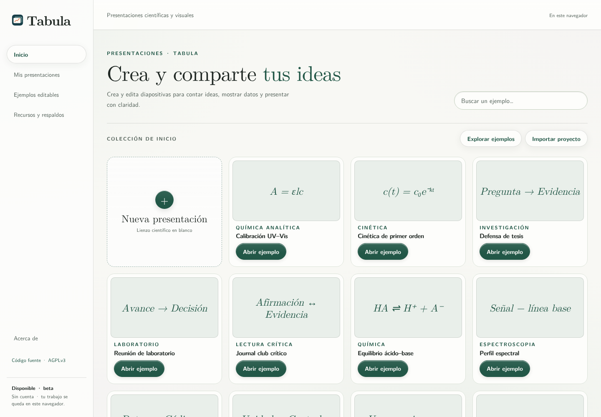
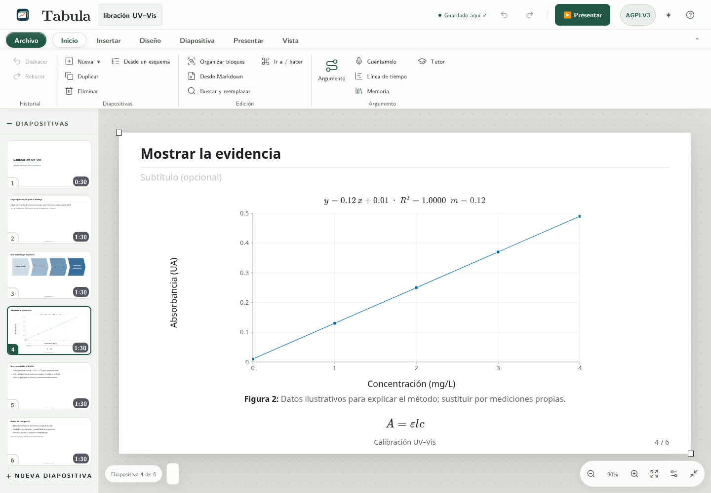
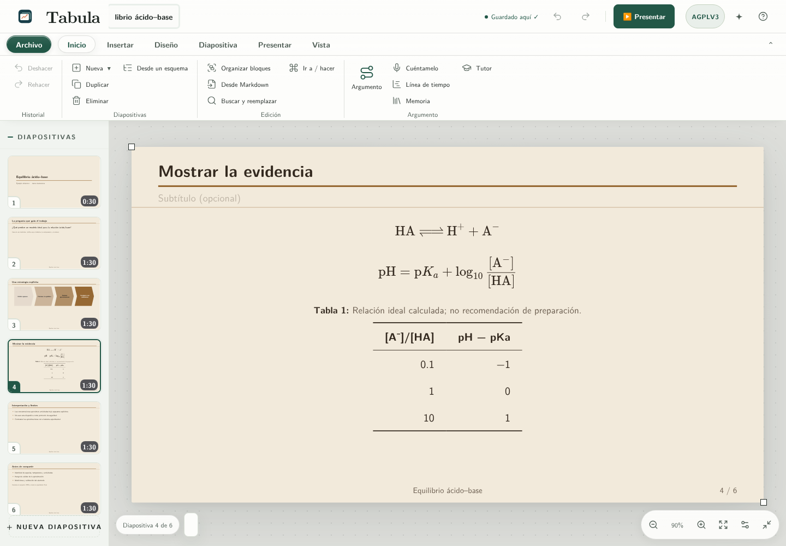

# Tabula: presentaciones

**Presentaciones libres, editables y hechas en tu dispositivo.**

Tabula reúne edición de diapositivas, herramientas visuales y científicas y modo de presentación en una aplicación local, sin cuenta ni suscripción. Nace de Erlen Slides y conserva la compatibilidad con sus proyectos.

**Versión 0.3.0 · beta · AGPLv3.** Publicación independiente del módulo Presentaciones de Erlen, con auditoría científica y paquetes reproducibles. Interfaz en español.



[Empezar](#empezar) · [Ejemplos editables](examples/README.md) · [Cómo es la interfaz](docs/interfaz.md) · [Manual](docs/uso.md) · [English](docs/README.en.md) · [Citar](CITATION.cff)

## Del resultado a la diapositiva



- **Comunicación científica:** ecuaciones LaTeX, reacciones, estructuras químicas, tablas, gráficas con datos editables —con barras de error y ejes logarítmicos—, diagramas y montajes de laboratorio.
- **Preparación:** notas del orador, tiempos, revisión del contenido, orden de diapositivas y modos de ensayo/presentación.
- **Archivos propios:** biblioteca local, proyecto JSON, plantillas personales, identidad institucional y copias de recuperación.
- **Guion y edición visual:** importar/exportar Markdown, previsualizar temas con tu contenido, agrupar, bloquear, alinear y mover varios bloques, y crear diagramas Mermaid con su fuente guardada. El lienzo libre ofrece posiciones, selección múltiple, capas y guías de ajuste en las diapositivas que admiten bloques.
- **Importación y figuras:** una entrada para JSON, PPTX y Markdown, con vista previa antes de guardar una copia. PowerPoint se adapta a bloques de Erlen; sus gráficas se recuperan como tablas de datos. Las figuras por capas conservan objetos editables y pueden crearse mediante lista y controles de teclado.
- **Compartir con revisión:** elige formato y revisa recortes, descripciones accesibles, recursos externos y límites de edición. Las notas privadas se incluyen en PowerPoint y HTML solo si marcas la opción; el proyecto JSON siempre las conserva.
- **Desde Erlen DoE:** el informe de un análisis llega como presentación nueva para la reunión de grupo, con vista previa, tablas recortadas a lo que cabe, gráficas editables y la procedencia en la última diapositiva. [Cómo funciona](docs/uso.md#un-informe-de-erlen-doe-como-presentación).
- **Exportaciones:** PDF mediante impresión, PowerPoint con objetos compatibles editables, fuente Beamer, SVG científico, Markdown, HTML imprimible y presentación HTML autónoma con funciones interactivas. Grabación local con micrófono opcional. Cada formato tiene [límites documentados](docs/uso.md#exportaciones).
- **Herramientas libres:** KaTeX, RDKit, Kekule.js, 3Dmol.js, Plotly, Mermaid, Reveal.js, PptxGenJS, pptxtojson y Fabric.js. Los componentes adicionales se cargan desde los archivos de la propia aplicación.

La ayuda por reglas sigue disponible. Su pestaña **Conversar con IA** conecta, si la persona lo configura, con un servicio de IA en la nube compatible con Chat Completions y llamadas de herramientas: puede proponer cambios y editar la presentación abierta. La clave y la dirección permanecen solo en la sesión. También existe el [servidor MCP](docs/mcp.md) para asistentes externos. La aplicación no incorpora cuentas, cobro, sincronización en la nube ni coedición simultánea; el proveedor de IA elegido puede aplicar sus propias tarifas.

## Empezar

La versión actual se ejecuta desde el código fuente; necesitas Node.js 22 o superior y npm:

```sh
git clone https://github.com/erlen-frontier/erlen-slides.git
cd erlen-slides
npm ci
npm run build
npm test
npm start
```

El servidor escucha únicamente en `127.0.0.1:8130`. La instalación inicial descarga dependencias; después la edición y el cálculo local pueden funcionar sin Internet. Las consultas voluntarias a Crossref o Zotero Web sí necesitan conexión.

El build también genera `public/erlen-slides-offline.html` para la edición básica. Las bibliotecas científicas, Markdown, Mermaid, PowerPoint editable y la presentación HTML autónoma necesitan servir la carpeta `public` completa, como hace `npm start`.

En [Releases](https://github.com/erlen-frontier/erlen-slides/releases) está disponible la versión histórica 0.1.0; no contiene necesariamente las funciones descritas para el código actual. Todavía no hay un paquete 0.3.0 publicado allí.

## Doce ejemplos completos

Cada ejemplo contiene **seis diapositivas**, notas, archivo JSON editable, fuente Beamer y una guía de adaptación. Son casos de trabajo científico con **datos explícitamente ilustrativos**, no experimentos realizados ni publicaciones inventadas.

| Caso de uso | Qué puedes practicar |
|---|---|
| [Calibración UV–Vis](examples/calibracion/) | Patrones, unidades e intervalo de trabajo |
| [Cinética](examples/cinetica/) | Modelo, datos y límites de interpretación |
| [Defensa de tesis](examples/defensa/) | Pregunta, comparación y contribución |
| [Reunión de laboratorio](examples/reunion-laboratorio/) | Avances, controles y siguiente decisión |
| [Journal club](examples/journal-club/) | Lectura crítica de un artículo real |
| [Equilibrio ácido–base](examples/equilibrio-quimico/) | Reacciones, ecuaciones y aproximaciones |
| [Espectroscopia](examples/espectroscopia/) | Señal sintética y preprocesamiento |
| [Análisis reproducible](examples/reproducibilidad/) | Código, datos y entorno |
| [Diseño experimental](examples/diseno-experimental/) | Unidad experimental y controles |
| [Congreso](examples/congreso/) | Una figura y un mensaje central |
| [Derivación](examples/derivacion/) | Pasos matemáticos e hipótesis |
| [Datos abiertos](examples/datos-abiertos/) | Archivos, diccionario y cita |



## Guardado y privacidad

El autoguardado usa el almacenamiento de **este navegador y este origen web**. Borrar los datos del sitio, cambiar de navegador o moverlo a otra dirección no traslada tu biblioteca. Descarga proyectos JSON y respaldos ZIP. El historial de recuperación local no sustituye una copia externa.

Tabula conserva las claves de almacenamiento de Erlen Slides para que las bibliotecas existentes del mismo navegador y origen sigan disponibles. Para traer una presentación desde otro navegador u origen, expórtala como JSON e impórtala aquí. La única excepción es explícita: una copia que Erlen DoE envía a Slides por la suite, que se abre solo desde su enlace y solo se guarda tras confirmarla. No contiene configuración de producción, telemetría automática ni claves de servicios.

## Desarrollo y validación

Lee [Arquitectura](docs/desarrollo.md), [Validación](docs/validacion.md) y [Contribuciones](CONTRIBUTING.md). Las capturas proceden de Chromium; las pruebas de integración con JSDOM simulan geometría y no sustituyen la inspección visual. Las exportaciones deben revisarse antes de enviar un trabajo científico.

## Escritorio en Linux

La versión de escritorio está en desarrollo con Tauri y un núcleo Rust. Utiliza el WebView del sistema y conserva el editor y sus bibliotecas locales; Node.js solo se necesita para construirla. La primera operación trasladada a Rust es el guardado de proyectos JSON mediante un diálogo nativo y una escritura que conserva el archivo anterior si falla.

La biblioteca de la aplicación de escritorio es independiente de la del navegador. Para llevar una presentación existente, expórtala como JSON desde el navegador e impórtala en la app. Consulta los requisitos y pasos en [Escritorio Linux](docs/escritorio-linux.md).

## Licencia y cita

El código original, documentación y ejemplos de este repositorio se publican bajo **GNU Affero General Public License v3.0 únicamente**: [LICENSE](LICENSE), identificador `AGPL-3.0-only`. Los componentes de terceros conservan sus licencias y atribuciones: [THIRD_PARTY_NOTICES.md](THIRD_PARTY_NOTICES.md).

La interfaz contiene un enlace visible al código fuente. Si modificas y despliegas esta aplicación, conserva el acceso al código fuente correspondiente de tu versión y revisa los términos de la licencia.

[CITATION.cff](CITATION.cff) y [.zenodo.json](.zenodo.json) describen la versión. El depósito de Zenodo se documentará con su DOI **cuando esté confirmado**; no hay un DOI provisional inventado. [Proceso de publicación](docs/publicacion.md).

## Código y verificación

Esta actualización incorpora la versión de Slides de Erlen Suite correspondiente al commit `c8e743be0c0b88433cdf7a2807e6757c03e873af`, junto con los recursos compartidos necesarios para ejecutarla de forma autónoma. La política actual retira la sincronización automática con Suite; la compilación y las pruebas se ejecutan localmente. El repositorio conserva workflows históricos: comprueba la configuración de Actions antes de publicar una etiqueta.
