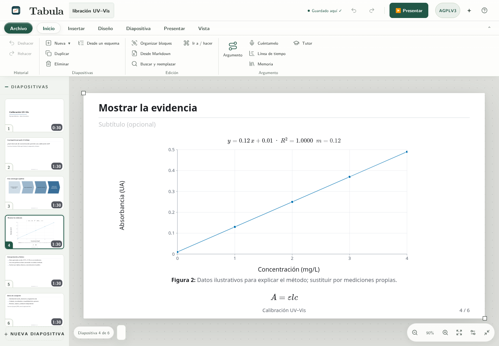

# Tabula: presentations

An open-source presentation editor for the browser and Linux desktop. Tabula builds on Erlen Slides and keeps its project compatibility. Spanish interface; no account required. Includes LaTeX equations, chemical reactions and structures, editable charts with error bars and logarithmic axes, tables, presenter tools, local recovery, and JSON/PDF/PPTX/Beamer/HTML export workflows.

To run the current source version, use Node.js 22+ and run `npm ci`, `npm run build`, `npm test`, and `npm start`. Open `http://127.0.0.1:8130`. The historical 0.1.0 version is available in [Releases](https://github.com/erlen-frontier/erlen-slides/releases); it may not include the features described here.

The standalone offline HTML supports core editing. The optional RDKit/Kekule/3Dmol/Plotly tools need the complete `public/` directory served through HTTP, which may be entirely local. Crossref and Zotero Web are optional network actions. There is no bundled production account, telemetry configuration, billing or real-time collaboration.

To move a presentation between browsers or origins, export and import its JSON project. Tabula does not support app-to-app copy exchange or conversion of other tools' specific reports. The general [MCP server](mcp.md) remains available for external assistants.

Thirteen [worked examples](../examples/README.md) provide 78 editable slides, JSON projects and Beamer sources. All numerical data are illustrative, not observations or reported scientific discoveries. Beamer compilation and pixel-identical rendering in every PowerPoint version are not certified.

## Development and verification

This repository works without CI or guaranteed code review. Builds and available checks run locally when the environment permits; releases are published manually. Record the commands actually run, their results and anything left unverified. Skipped checks are not passed checks, and historical results do not validate the current source. The lack of CI is part of the workflow, not a requirement to add automation. Tabula is independent and does not automatically synchronize with Erlen Suite.

See the [local agent rules](../AGENTS.md), [development guide](desarrollo.md), [historical validation record](validacion.md) and [contribution guide](../CONTRIBUTING.md). JSDOM simulates geometry and is not real-browser visual validation. Inspect exported files before using them for scientific communication.

## License and citation

License: **AGPL-3.0-only**, with separately licensed third-party components. See [notices](../THIRD_PARTY_NOTICES.md). Citation metadata are in [CITATION.cff](../CITATION.cff). A Zenodo DOI will be added only after a confirmed deposit.
