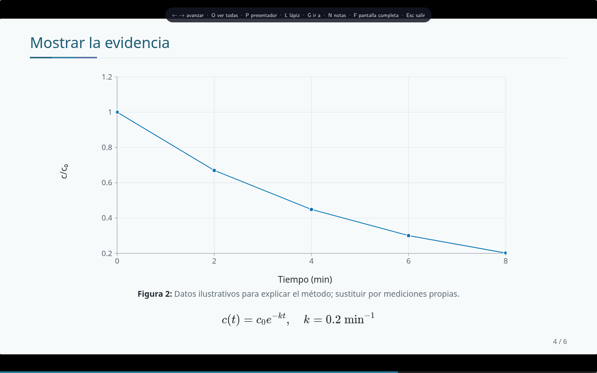
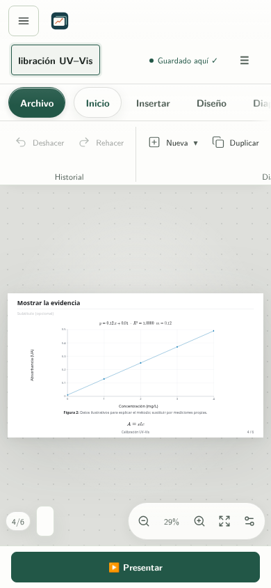

# La interfaz, con ejemplos reales de la aplicación

Estas imágenes son capturas de Chromium, tomadas con proyectos didácticos de este repositorio. Son de una versión anterior y pueden diferir de la interfaz independiente, en particular de los controles de Apariencia.

## Inicio

La navegación local organiza Inicio, Mis presentaciones, Ejemplos editables y Recursos. La acción principal crea una presentación vacía; las tarjetas abren copias editables de los ejemplos. **Apariencia** permite ajustar el tema, el acento y el estilo de la aplicación. El enlace al código y su licencia está en la barra lateral.

## Editor científico

Arriba, la barra con la marca, el título, el guardado y «Presentar»; debajo, la cinta de herramientas del editor («Archivo», Inicio, Insertar, Diseño, Diapositiva, Presentar, Vista y la pestaña del bloque seleccionado). Debajo, de izquierda a derecha: secuencia de diapositivas, lienzo y, cuando lo pides desde la cinta, el panel de detalles. Debajo del lienzo están posición, zoom y vista general. El gráfico del ejemplo conserva sus datos; no es una captura pegada.

Al seleccionar un objeto, una barra sobre el lienzo muestra las acciones correspondientes a texto, imágenes o formas junto con las acciones de organización. El panel de capas puede permanecer abierto mientras se usa la barra y la diapositiva.

## Química y matemáticas

Las reacciones y ecuaciones se componen tipográficamente. Las tablas permanecen editables. Los supuestos del modelo se explican en la misma presentación.

## Frente a la audiencia

El modo de presentación dedica el espacio al contenido, con navegación por teclado, notas y herramientas de exposición.

## Pantalla estrecha

La cinta se desplaza en horizontal dentro de su franja; el panel de detalles se abre como cajón desde la cinta o desde el botón ☰. En la vista general se puede mover la diapositiva actual con botones o con Alt y las flechas.

## Reproducir las capturas

Construye y ejecuta la app. `node herramientas/capture-pages.mjs` prepara escenas temporales `_capture-*.html` en `public/`. Por ejemplo, Firefox puede capturar `http://127.0.0.1:8130/_capture-editor.html` con `--headless --screenshot` y un perfil temporal vacío. Usa 1440 × 1000 para escritorio y 390 × 844 para móvil. Estas escenas no deben incluirse en el paquete de distribución; el empaquetador las excluye.
